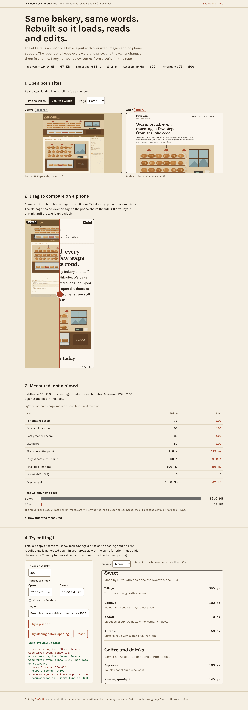
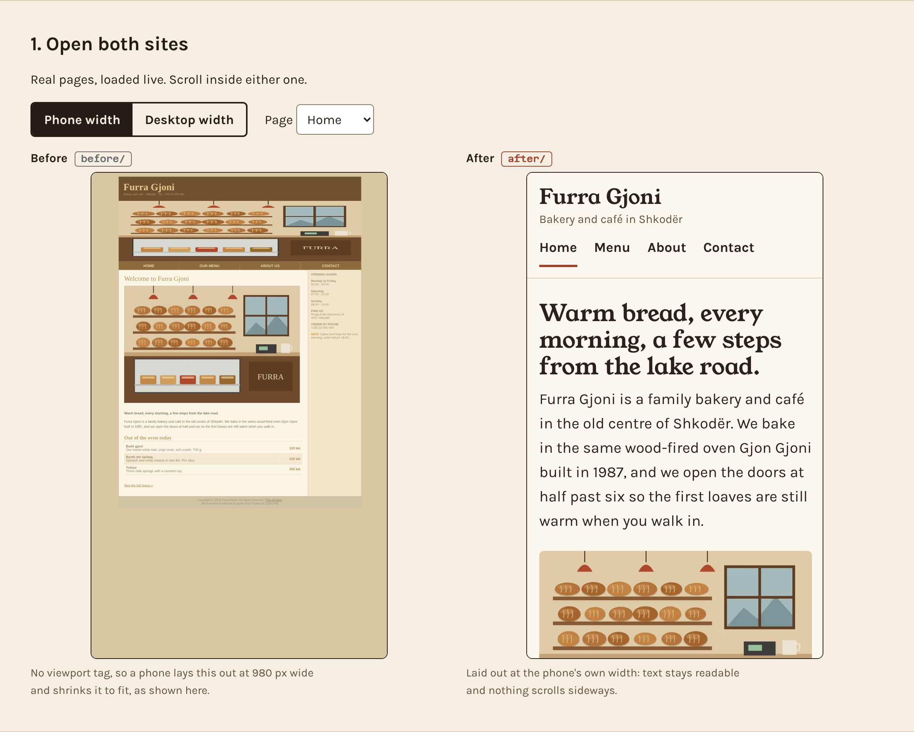
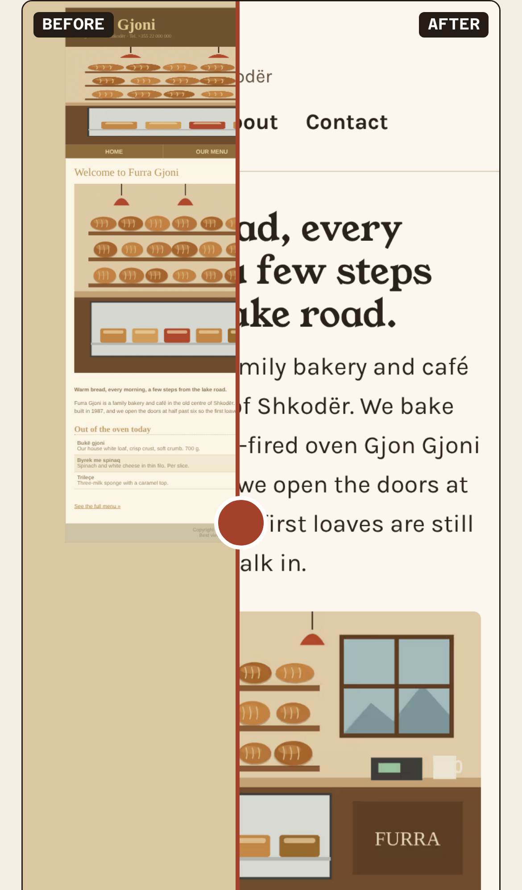
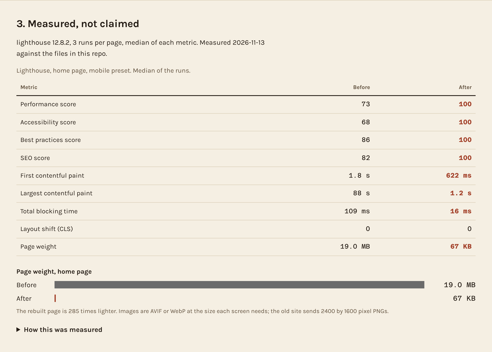
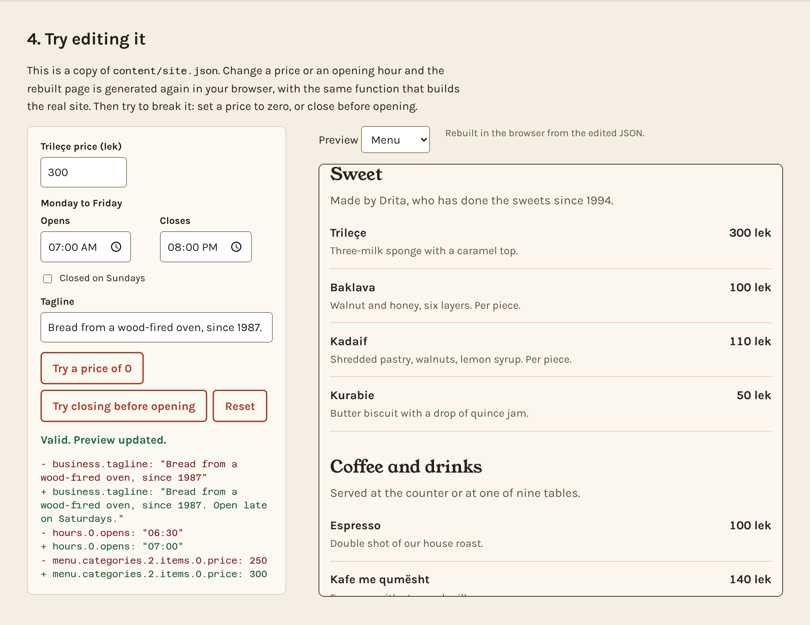
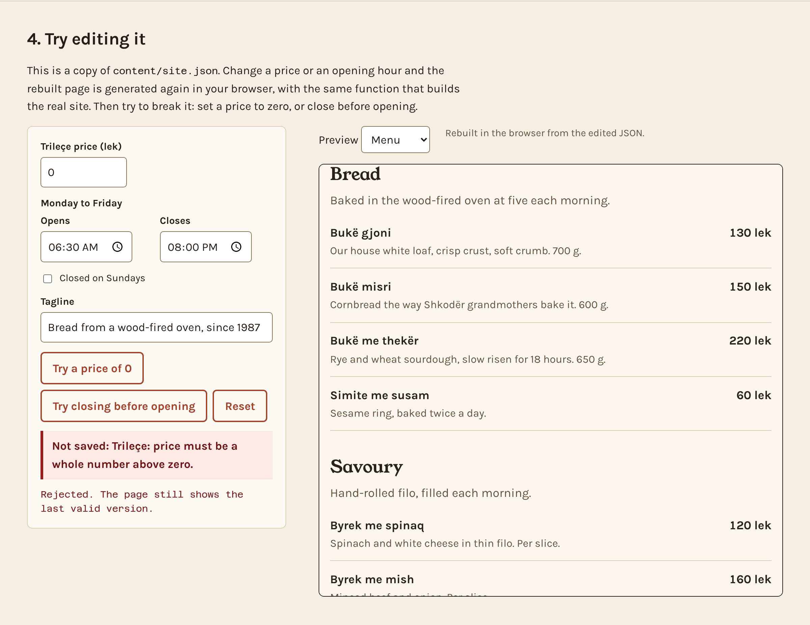

# Website rebuild: an old bakery site made fast, readable on phones and editable by the owner

Small-business websites get slow, look broken on phones and need a developer for every price change. This repo takes one dated site, rebuilds it with the same words, and measures both with Lighthouse so the difference is a number, not an opinion.

**▶ Live demo: https://enxo7899.github.io/before-after-rebuild/** (open both sites side by side, drag the phone comparison, then change a price in "Try editing it")



*Furra Gjoni is a fictional bakery and café in Shkodër. Nothing here is client work.*

## What it does

| Capability | Detail |
|---|---|
| Old site (`before/`) | Four pages in a 2012 style: table layout, jQuery 1.x and three plugins in the head, 2400 by 1600 PNGs, no viewport tag, low-contrast text, no description |
| Rebuilt site (`after/`) | Semantic HTML, responsive from 320 px, AVIF and WebP at three sizes, two self-hosted fonts, inline CSS, no JavaScript needed to read it |
| Editable by the owner | Every word, price and opening hour lives in `content/site.json`. `after/edit.html` is a form for it that downloads the edited file |
| Local search | `LocalBusiness` (Bakery) structured data with address, phone and opening hours, generated from the same JSON |
| Accessibility | Skip link, visible focus, landmarks, alt text on every image, contrast checked by Lighthouse |
| Measured | `npm run lighthouse` runs Lighthouse on both home pages, mobile preset, three runs, and writes `docs/lighthouse.json` |

## Measured

Lighthouse 12.8.2, mobile preset (simulated slow 4G, 4x CPU slowdown), home page, median of 3 runs, served from a local server on 127.0.0.1 without compression for both sites.

| | Before | After |
|---|---:|---:|
| Performance | 73 | 100 |
| Accessibility | 68 | 100 |
| Best practices | 86 | 100 |
| SEO | 82 | 100 |
| First contentful paint | 1.8 s | 0.6 s |
| Largest contentful paint | 87.7 s | 1.2 s |
| Total blocking time | 109 ms | 16 ms |
| Page weight | 19.0 MB | 66.6 KB |

The before site scores 73 on performance only because its layout does not shift and its scripts are small. Its largest paint is 88 seconds on the simulated slow connection because the page ships about 19 MB of PNG. Numbers vary a little between machines; rerun with `npm run lighthouse`. These are lab measurements, not data from real visitors.

| Phone, side by side | Drag to compare | Scores and weight |
|---|---|---|
|  |  |  |

| Try editing: change a price | Try to break it: price of 0 is refused |
|---|---|
|  |  |

## How the owner edits the site

1. Open `after/edit.html` (on the live site: the "Owner: edit this site" link in the footer). It loads `site.json` into a form.
2. Change a price, an opening time, the intro text. The form refuses a price of zero or a closing time before the opening time.
3. Press **Download site.json**.
4. On GitHub, open `content/site.json`, choose Edit, paste the new contents and commit (or drag the file into the `content` folder).
5. The Pages workflow runs the tests and publishes `after/`. On Netlify, set the build command to `npm run build` and the publish directory to `after`. Locally, `npm run build` rewrites `after/*.html` from the JSON.

`scripts/build.mjs` validates the JSON first and refuses to write pages if it is invalid, so a typo cannot publish a broken site.

## Run it

```bash
npm install
npm test                  # 17 tests
npm run build             # content/site.json -> after/*.html
npm run images            # redraws the illustrations, the old PNGs and the responsive AVIF/WebP
npm run lighthouse        # Lighthouse x3 on before/ and after/, writes docs/lighthouse.json
npm run dev               # http://127.0.0.1:5181 (comparison page), /before/ and /after/
npm run screenshots       # with dev running: regenerates docs/*.png, fails on console errors
```

Lighthouse needs Chrome. The script uses `/opt/pw-browsers/chromium` if present, otherwise set `CHROME_PATH`. `npm run screenshots` uses the globally installed Playwright.

The tests check that the built pages match what `site.json` renders, every price on the menu is in the HTML, every page has `lang` and a viewport tag, every image has alt text and size attributes, no page goes over its byte budget, local links resolve, the structured data is valid and matches the JSON, bad edits are refused, and the saved Lighthouse results show the rebuilt site at least as good on every category.

## Adapt it to your business

- **Content:** replace `content/site.json` (name, hours, menu categories and items, about text, contact). The page templates are in `src/render.mjs`, styling in `src/after.css`.
- **Photos:** put your own images through `scripts/make-images.mjs` (it resizes to AVIF and WebP at 480, 800 and 1200 px); keep `width`, `height` and alt text in `images`.
- **A clinic or a shop:** rename the menu categories to services or products; the same price and hours rules apply.
- **Old site:** `before/` is generated by `scripts/make-before.mjs` from the same JSON and is only there as the comparison.

Fonts are Young Serif and Karla for the rebuilt site and Karla with Azeret Mono on the comparison page, all self-hosted from `after/fonts/` (SIL Open Font License).

---
Built by **[EmSoft](https://github.com/enxo7899)**: website rebuilds that are fast, accessible and editable by the owner. Get in touch through my Fiverr or Upwork profile.
